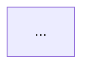

# 문서 + 대본 세트 형식

두 파일은 한 세트다. **문서**(`walkthrough.md`)는 화면에 띄우고, **대본**(`script.md`)은 발표자가 읽는다. 대본의 모든 문단은 문서의 어느 위치를 보여주고 있는지 큐(🎬)로 시작한다. 장면 번호 N은 문서 섹션 번호 = 대본 큐 번호 = 투어 스텝 번호다.

## walkthrough.md (화면용)

```
# <작업 이름>

**한 줄 요약.** 〈목적〉을 위해 〈무엇〉을 〈어떻게〉 바꿨다.

| 커밋 | 제목 | 장면 |
|---|---|---|
| abc1234 | ... | 2, 3 |

## 1. 전체 지도
**핵심**: 한 문장.



## 2. <장면 제목>
**핵심**: 한 문장.

- 변경 요약 bullet 2~4개

`src/foo.ts:10-24` — before
```ts
...
```
`src/foo.ts:10-31` — after
```ts
...
```

(visual이 있으면 mermaid 1개)

근거: abc1234, def5678

## N. 검증과 남은 일
- 어떻게 확인했나 (테스트 명령, 수동 확인 절차)
- 아직 안 한 것
- 주의점 (마이그레이션, 설정, 배포 순서)

## 예상 질문
- **Q.** ... — **A.** ...
```

규칙:

- 장면 헤딩은 반드시 `## N. 제목` (N, 점, 공백). 대본이 이 번호와 제목으로 참조한다.
- 코드는 before/after 각 15줄 이내. 긴 함수는 핵심 줄만 남기고 `// ...`로 생략한다. 펜스 위에 `파일:라인` 표시.
- 다이어그램은 1번 장면에 1개(전체 지도) + visual이 있는 장면에 1개씩. 장면당 최대 1개.

## script.md (발표자용)

```
# <작업 이름> — 대본

예상 시간 ~M분 · 청중: <청중> · 준비: walkthrough.md를 화면에 열어둔다

### 1. 전체 지도  (~1분)
> 🎬 문서 §1「전체 지도」 — 다이어그램이 화면에 보이게

<읽는 말. 구어체. 이 작업이 왜 필요했는지 한두 문장, 그림에서 어디를 볼지 한 문장.>

<전환문 한 문장: "그럼 실제로 어디를 바꿨는지 보겠습니다.">

### 2. <문서 헤딩과 동일한 제목>  (~2분)
> 🎬 문서 §2「<제목>」 — before 코드 블록

<읽는 말>

> 🎬 §2 after 코드로 스크롤

<읽는 말>

> 💬 예상 질문 "..." → 한 줄 답
```

규칙:

- 큐(🎬)는 항상 blockquote, 말은 항상 평문. 한 큐 = 문서에서 화면에 보여야 하는 것 하나. 장면 진입 큐는 `§N「제목」` 형식으로, 제목은 문서 헤딩과 글자까지 같게.
- 말은 문장당 20단어 안, 장면당 6~10문장. 문서에 이미 있는 숫자·파일명은 다시 읊지 않고 "여기 보시는 것처럼"으로 가리킨다.
- 말 안에 마크다운 표·코드 블록·bullet 금지 — 읽을 수 없다.
- 각 장면 끝에 다음 장면으로 넘어가는 전환문 한 문장.
- 예상 질문(💬)은 장면 목록의 `qa`에서 온다. 문서의 "예상 질문" 섹션과 같은 내용.

## mermaid 규칙

- 라벨에 `()`, `[]`, `{}`, `|`, `;`, `"`가 들어가면 `A["라벨"]`로 감싼다.
- 한글 라벨은 그대로 쓴다. `:`는 sequence 문법과 겹치므로 라벨 안에서 피한다.
- 다이어그램 하나에 노드 12개 이하. 넘치면 장면을 나눈다.
- `graph` 대신 `flowchart`를 쓴다. 방향은 LR 기본, 단계가 5개 넘으면 TB.
- 변경 전/후를 한 그림에 넣을 때는 `subgraph before` / `subgraph after` 또는 바뀐 노드에 `:::changed` 클래스 + `classDef changed fill:#fde68a`로 표시한다.
